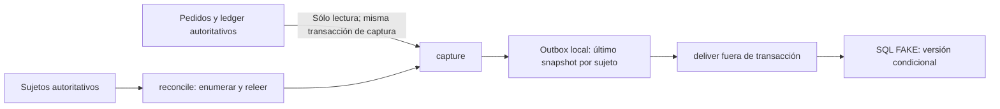

# Espejo de fidelidad: contrato exclusivamente local

Base: PR46, `96f1f5a23dd087ad4ebfcf36b73f8f01b46ac0af`. Código final probado: **`263aea6cfa7bd74419f5270b7bac427b99c0c706`**. Trabajo autorizado de contrato y pruebas; sin GHL HTTP, credenciales, rutas, migraciones, cambios de UI/preview, pagos o activación productiva.

## Decisión y frontera

La auditoría no encontró un cliente GHL ni outbox reutilizable. El núcleo [`loyalty.server.ts`](../src/server/loyalty/loyalty.server.ts) ya deriva progreso y revisión desde el ledger dentro de una transacción. Se conserva sin cambios. No se reutiliza email/teléfono o el identificador de rate-limit como identidad de cliente.

La implementación nueva está limitada a estos componentes y sus pruebas:

- [`loyalty-mirror.server.ts`](../src/server/loyalty/loyalty-mirror.server.ts): puertos internos y operaciones `capture`, `deliver` y `reconcile`; sin consumidores de aplicación.
- [`loyalty-mirror-sqlite-store.cjs`](../tests/support/loyalty-mirror-sqlite-store.cjs): adaptador de fixtures que relee el núcleo real y persiste la proyección/outbox en SQLite local.
- [`fake-loyalty-mirror-transport.cjs`](../tests/support/fake-loyalty-mirror-transport.cjs): receptor explícitamente FAKE en otro archivo SQLite; simula aplicación condicional por versión.
- [`loyalty-mirror.test.cjs`](../tests/loyalty-mirror.test.cjs): pruebas del coordinador, persistencia, fallos, aislamiento y carreras locales. El loader de prueba no conecta rutas ni transporte real.

Se evaluaron una notificación dentro de la transacción económica, un outbox insertado por cada mutación y una captura independiente del último estado. Se elige la tercera para este alcance local: no acopla disponibilidad del espejo al crédito/canje ni modifica la transacción del núcleo. Es decisión técnica de esta implementación, no una política comercial aprobada.

Cada captura interna recibe sólo el sujeto del backend; relee progreso autoritativo, binding local y versión anterior en UNA transacción serializada. Si el resumen no cambia conserva la versión y el estado pendiente. Si cambia, incrementa la revisión persistida del sujeto y sustituye el pendiente con un snapshot completo. Un aviso duplicado o antiguo sólo provoca otra lectura actual; no aporta un saldo ni un delta.

La transacción de captura es independiente de la transacción económica ya confirmada, pero mantiene juntas la lectura autoritativa y la asignación de versión. El adaptador de fixtures reutiliza la transacción abierta para leer el núcleo, sin iniciar otra transacción anidada. No se leen datos fuera para asignarles después una revisión más nueva. Un fallo de captura no revierte un crédito o canje previo. SQLite serializa estas operaciones locales con `BEGIN IMMEDIATE`; esto no valida aislamiento, locks o RLS de PostgreSQL/Supabase.



La entrega se hace fuera de esa transacción. Los intentos tienen semántica **at-least-once**: puede enviarse varias veces el mismo mensaje estable. El ACK debe coincidir con la tupla completa `(subjectId, destinationRef, messageId, revision, payloadHash)` y un estado aceptado. Sólo `applied` o `duplicate` permiten intentar limpiar el pendiente mediante comparación y actualización condicional (CAS) de esa misma tupla y `pending = 1`. `stale` conserva el caso para reintento/revisión como `destination_ahead`: no prueba que el snapshot local se haya aplicado. Una respuesta o fallo viejo no puede limpiar un snapshot nuevo ni sustituir sus metadatos. No se guarda texto de excepciones del transporte como dato comercial.

Los errores de persistencia del store se propagan al llamador, incluso al registrar un fallo o guardar un ACK. Tras un error hay que releer el estado persistido antes del reintento: un ACK puede haberse confirmado con COMMIT y haberse perdido sólo la respuesta. En ese caso el pendiente ya estará limpio; no se fuerza una segunda aplicación ni se revierte el ledger. La pérdida de respuesta del transporte también puede ocurrir después de aplicar en el receptor FAKE; el reintento del mismo mensaje obtiene `duplicate`.

Una captura fallida puede no dejar fila pendiente. `reconcile()` recorre sujetos autoritativos y vuelve a capturar; no se limita al outbox. El outbox agrupa las capturas en el último estado por sujeto: recupera el estado vigente, no cada transición intermedia, y no es event sourcing. `reconcile()` captura; no despacha automáticamente los pendientes. No se implementan reloj, presupuesto de reintentos, backoff, scheduler ni rutas. Las pruebas invocan las operaciones de forma explícita; no se promete que la reconciliación o entrega ya corran en producción.

## Contrato del destino, no API de GHL

Los nombres `schema`, `messageId`, `subjectId`, `destinationRef`, `revision`, `payloadHash` y `summary` son de un protocolo interno nuevo. No son endpoints, campos personalizados ni respuestas documentadas de GHL. El binding de fixtures es opaco, explícito e inmutable; no decide cómo identificar, fusionar o reasignar contactos reales.

El resumen contiene sólo agregados del progreso y la regla autorizada diez pedidos→2bagels+1schmear. No envía pedidos, evidencia de pago, nombres, email, teléfono, tokens, IDs de derechos o solicitudes de canje. `unredeemedRewards` no otorga autorización de canje y `requiresReview` debe conservarse; no se decide una devolución o reversión desde el espejo.

SHA-256 identifica el contenido normalizado del resumen para detectar cambios y comparar reintentos. No autentica al emisor, no acredita identidad, no firma el mensaje y no demuestra un pago. El orden de claves del JSON persistido se normaliza antes de comprobar el hash; reordenar las claves sin cambiar valores no crea otra versión ni bloquea el ACK. La autoridad continúa en el store/núcleo del backend, sin handoff real a otro sistema.

El puerto de transporte exige que el destino aplique una revisión nueva, reconozca el mismo contenido repetido y rechace el retroceso de versión. El receptor SQLite **FAKE** lo simula con persistencia real local e aislamiento entre sujetos. No está verificado que GHL permita ese contrato condicional. Un adaptador real permanece ausente: antes de implementarlo se deben verificar documentación/capacidades, binding/tenancy, autenticación, permisos, aislamiento, garantías de orden, límites y reconciliación. Si el destino no ofrece control de versión suficiente habrá que rediseñar esa frontera; un GET seguido de PATCH no demuestra atomicidad. No hay entrada desde GHL ni permisos del espejo para acreditar pedidos o consumir derechos. No se añade una política de identidad, devolución, caducidad o cumplimiento del regalo.

Los reintentos pueden producir múltiples entregas físicas. No se promete exactamente-una-vez distribuido, latencia, entrega eventual sin worker/rescan activo ni ausencia de regresión en GHL real. La idempotencia y el rechazo de versiones viejas sólo se comprueban en el contrato y receptor locales.

## Validación

Resultados leídos de los logs del código **`263aea6cfa7bd74419f5270b7bac427b99c0c706`** y del [resumen de evidencia](qa/loyalty-mirror-local-20261101/summary.json). Node `v24.19.0`, SQLite `3.53.3`. Sólo fixtures y archivos temporales locales; no se instalaron dependencias nuevas. La revisión independiente final comunicada no encontró hallazgos Critical/Important; el hallazgo menor del orden JSON quedó corregido y verificado en este SHA.

| Etapa | Resultado y límite |
| --- | --- |
| RED inicial | 28/28 fallan frente al scaffold sin implementar; exit 1. [Log](qa/loyalty-mirror-local-20261101/red-scaffold-uncommitted.log). Estado diagnóstico sin commit, no atribuido al SHA final. |
| Primer candidato `8af7ad0d0901d00f11bf886092c60697f26b3b5a` | 28 pruebas nuevas verdes; suite completa 135/135 y build exit 0. [Suite](qa/loyalty-mirror-local-20261101/node-full-8af7ad0.log) y [build](qa/loyalty-mirror-local-20261101/build-8af7ad0.log), conservados como candidato anterior. |
| RED de regresión JSON | 1/1 falla con `projection_integrity_error` al reordenar claves persistidas; exit 1. [Log](qa/loyalty-mirror-local-20261101/red-json-order-uncommitted.log). Estado diagnóstico sin commit. |
| Espejo final | 29/29 PASS, incluidas las 28 anteriores y la regresión de orden JSON. Comprueba fallos de captura/entrega/ACK, respuesta perdida, snapshots posteriores, clientes aislados, reapertura y dos conexiones SQLite. |
| Suite Node completa final | **136/136 PASS**, 0 FAIL, 0 skipped; exit 0: 107 existentes repetidas + 29 nuevas. [Log](qa/loyalty-mirror-local-20261101/node-full-263aea6.log). |
| Build final | **Exit 0**: Vite, `tsc --noEmit`, QA estática, pedido manual y movimiento. [Log](qa/loyalty-mirror-local-20261101/build-263aea6.log). Las pruebas incluidas en build no se suman de nuevo al total Node. |
| Conservación de la base | Auditoría de 146 archivos existentes: ninguno modificado; núcleo económico sin cambios y cero consumidores runtime del espejo. Autodeploy desactivado. ZIP de preview intacto, SHA-256 `262b55db494a615299ad9123ac2b82a69b79950f318281d8b5652abe45de5ed6`. |
| Browser/visual | No repetido para esta entrega; bytes de UI preservados. No se atribuye una nueva aprobación visual a estas pruebas de backend. |
| GHL real, HTTP, credenciales, producción, RLS/RPC y proveedor | **NO EJECUTADO / NO INSTALADO**. La condición por versión sólo se ha probado en el receptor FAKE. |

Comandos para reproducir las pruebas locales sobre el código indicado:

```sh
node --test tests/loyalty-mirror.test.cjs
QA_HDR_FIXTURE_PATH=/ruta/local/lebombo_1k.hdr node --test tests/*.test.cjs
npm run build
```

La suite específica del espejo no necesita HDR ni servicios; la suite completa conserva el fixture HDR heredado, con hash aprobado `a02c9615adeba91a753c3e4737c3ce7a719273df822eeaa85d24982bd43c9ecb`. El [resumen](qa/loyalty-mirror-local-20261101/summary.json) registra los SHA y resultados. El [manifiesto SHA-256](qa/loyalty-mirror-local-20261101/manifest.json) identifica los artefactos finales. Los `.log` legibles sólo normalizan ANSI y espacios al final de línea; sus `.log.gz` asociados conservan stdout/stderr exactos. Las pruebas locales y la revisión de código no certifican la identidad de producción, el DDL/RPC vigente, las garantías PostgreSQL ni la entrega a GHL.
